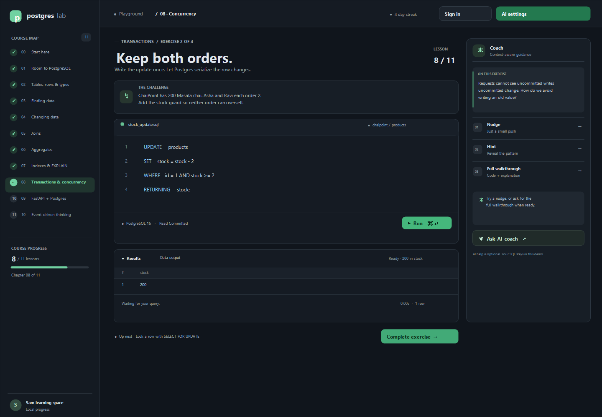

# Postgres and Event-Driven Backends for Android Developers

A hands-on course for an Android developer (Kotlin, Room, a little Python and FastAPI) who wants to learn SQL, PostgreSQL and event-driven backends. Written in a simple, step-by-step style with animated diagrams.

## Developer Studio

The course site uses a dark, code-first workspace with lessons, runnable examples, and contextual help.

Read it online: https://sumukhak.github.io/postgres-event-driven-for-android-devs/ (after GitHub Pages is switched to "GitHub Actions").

- Chapters are Markdown files in `src/`. `python tools/build.py` turns them into the site in `site/`.
- Every SQL example is run against a real PostgreSQL 16 by `python tools/run_sql.py` before it is published.
- Each chapter ends with a Sources list of official documentation.

## Course contents

| Chapter | Subject | What you'll learn |
| --- | --- | --- |
| [00 · Start here](src/00-start-here.md) | Course orientation | What you will build and how to use the lessons and playgrounds |
| [01 · From Room to Postgres](src/01-from-room-to-postgres.md) | Data storage | How local Room data maps to a PostgreSQL-backed application |
| [02 · Tables, rows, and types](src/02-tables-rows-types.md) | Data modeling | Designing tables, columns, and types for the ChaiPoint database |
| [03 · Asking questions with SELECT](src/03-select.md) | Querying | Reading and filtering data with `SELECT` |
| [04 · Changing data](src/04-changing-data.md) | Data changes | Using `UPDATE`, `DELETE`, and upsert safely |
| [05 · JOINs](src/05-joins.md) | Relationships | Combining related tables in a query |
| [06 · Aggregates](src/06-aggregates.md) | Summaries | Counting, summing, and grouping query results |
| [07 · Indexes and EXPLAIN](src/07-indexes-explain.md) | Query performance | Understanding indexes and investigating slow queries |
| [08 · Transactions and concurrency](src/08-transactions-concurrency.md) | Correctness | Handling simultaneous work with transactions and concurrency control |
| [09 · FastAPI and Postgres](src/09-fastapi-postgres.md) | Backend integration | Connecting a FastAPI application to PostgreSQL safely |
| [10 · Event-driven thinking](src/10-event-driven-thinking.md) | Event-driven systems | Telling the rest of a system what happened |
| [A1 · Windows install guide](src/A1-install-windows.md) | Setup | Installing the tools and finding no-install playgrounds |
| [A2 · Portfolio projects](src/A2-portfolio-projects.md) | Practice projects | Building three low-cost projects to demonstrate what you learned |
